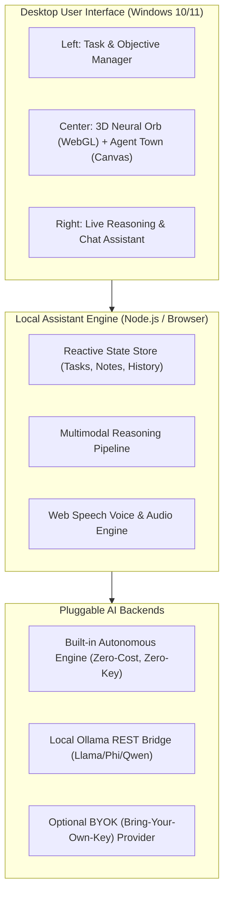

# Software Specification & Clean-Room Architecture Plan

## 1. Target Application Identification

- **Application Name**: Archer Ai
- **Package / Product ID**: `XP895HSHSTPGGX` (Microsoft Store)
- **Publisher / Developer**: MD. ABDUL SAMIR TUHIN (Habiganj)
- **Store Category**: Application (AI Desktop Assistant / Automation)
- **Official Package Version**: 1.0.57 (Updated October 2026)
- **Pricing Model**: Paid software with license activation & cloud subscription tiers
- **Verified Listing Description**:
  > *"Archer AI is a powerful AI-powered desktop assistant designed to help you think, create, automate, and get things done faster on Windows. With Archer AI, you can interact naturally through text and voice, work with files and documents, understand visual information, and use intelligent AI agents to assist with everyday tasks. It brings advanced AI capabilities directly to your desktop through a fast, modern, and intuitive experience."*

---

## 2. Verified Target Features & UI Layout

Based on public Store metadata and direct inspection of all 10 verified application screenshots:

### A. Three-Column Sci-Fi Desktop Layout
1. **Left Column (Productivity & Global Monitoring)**:
   - **Tasks & Notes Panel**:
     - Filter tabs: `ALL`, `PENDING`, `COMPLETED`, `HIGH`, `WORK`, `PERSONAL`.
     - Progress bar (e.g. `0/4 (0%)`).
     - Objective creator: text input, priority selector (`LOW`, `MEDIUM`, `HIGH`), category tag selector, and add button.
     - Interactive task list with status checkboxes and timestamps.
   - **Satellite Stream / World Monitor**:
     - 2D / 3D geospatial interactive globe and map.
     - Live global event indicators, weather/storm tracking, alert markers.
     - Bottom navigation: `Today`, `Map`, `Search`, `Alerts`, `More`.

2. **Center Column (Neural Core & Multi-Agent Simulation)**:
   - **Neural Core Dashboard**:
     - Interactive graph branches connecting to the core: `Memory`, `Soul` (persona/instructions), `Skills` (tools), and `Settings`.
     - Glowing 3D particle sphere / neural orb with animated rotation and status indicator (`• SYSTEM ACTIVE •`).
     - Quick action buttons: Camera Snapshot, Desktop Screen Capture, Microphone Voice Input, and `TERMINATE` control.
   - **Agent Town / Visual Hub**:
     - 2D pixel-art simulation depicting autonomous AI agents (`Alice`, `Bob`, `Carol`, `Dave`) working in an interactive office.
     - Agent status indicators (`Online`, `Busy`), context utilization bars (`CTX`), and desk interaction triggers (`Press E`).
     - Mode toggle: `AGENTS` (office simulation) vs `VISUAL HUB` (Mindmap knowledge graph & AI image gallery).

3. **Right Column (Contextual Reasoning & Chat Assistant)**:
   - **Live Reasoning Stream**: Visible chain-of-thought breakdown:
     - `**Initiating Contextual Analysis**`
     - `**Re-evaluating the Request**`
     - `**Defining the Goal**`
   - Real-time conversational interface with speech output.
   - Input bar with multimodal attachment support, Voice Assistant toggle, and Expert Agent switch.

---

## 3. Clean-Room Principles & Legal Boundaries

To ensure complete independence and respect intellectual property:
1. **No Proprietary Code or Binaries**: Zero decompilation, extraction, or copying of private code from the target application package.
2. **Original Branding & Assets**: All icons, graphics, animations, and sound effects must be newly authored or sourced from permissive open-source licenses (MIT/Apache 2.0).
3. **No Subscription / Authentication Bypassing**: We do not interface with or reverse-engineer the target's proprietary servers, Firebase endpoints, or licensing servers.
4. **Independent Implementation**: The replacement assistant—named **TRI AI Assistant**—will be built from scratch using modern web and desktop technologies (Node.js, HTML5 Canvas/WebGL, Web Speech API, and local AI adapters).

---

## 4. Free vs. Cloud Feature Matrix & Hardware Feasibility

| Feature | Free / Local Tier (Our Default) | Optional Cloud Tier | Hardware Requirements |
| :--- | :--- | :--- | :--- |
| **Desktop UI & 3D Neural Orb** | 100% Free (WebGL / Canvas) | None | Any standard GPU / integrated graphics |
| **Task & Notes Management** | 100% Free (Local SQLite/JSON storage) | None | Minimal CPU & disk |
| **Mindmap Visual Hub** | 100% Free (Interactive HTML5 Canvas) | None | Minimal CPU |
| **Agent Town Office Simulation** | 100% Free (2D Canvas game loop) | None | Minimal CPU |
| **Voice Synthesis & Recognition** | 100% Free (Browser Web Speech API) | Optional Cloud TTS | Microphone & audio output |
| **Desktop Screen Capture** | 100% Free (WebRTC / Windows API) | None | Any standard Windows 10/11 system |
| **AI Reasoning & Chat** | **100% Free**: 1. Built-in instant deterministic reasoning engine. 2. Local LLM via **Ollama** (Llama 3, Phi-3, Mistral, Qwen). | Optional Gemini / OpenAI API key (user-supplied) | Built-in: <100MB RAM. Local LLM: 8GB–16GB RAM (or 4GB+ VRAM). |

---

## 5. Architectural Design of "TRI AI"

---

## 6. Phase 1 Implementation Scope (First Working Prototype)

1. **Complete Futuristic Sci-Fi UI**:
   - High-fidelity dark HUD styling with glowing neon accents.
   - 3D animated mathematical particle sphere (Neural Core) running via WebGL/Canvas with speed and reaction dynamics.
   - 2D Canvas Agent Town simulation with animated agent characters at desks.
   - Interactive Visual Hub (Mindmap graph generator).

2. **Full Productivity & Task Engine**:
   - Interactive task creation with priorities (`LOW`, `MEDIUM`, `HIGH`), categories (`WORK`, `PERSONAL`), and completion status.
   - Real-time progress bar calculation.

3. **Autonomous Reasoning & Chat Assistant**:
   - Zero-cost out-of-the-box local intelligence engine capable of step-by-step reasoning (`Initiating Contextual Analysis` $\to$ `Defining the Goal` $\to$ `Execution`).
   - Native browser Text-to-Speech and Speech Recognition (hands-free voice interaction).
   - Pluggable adapter to connect to local Ollama instances (`http://localhost:11434`) with zero configuration if installed.
